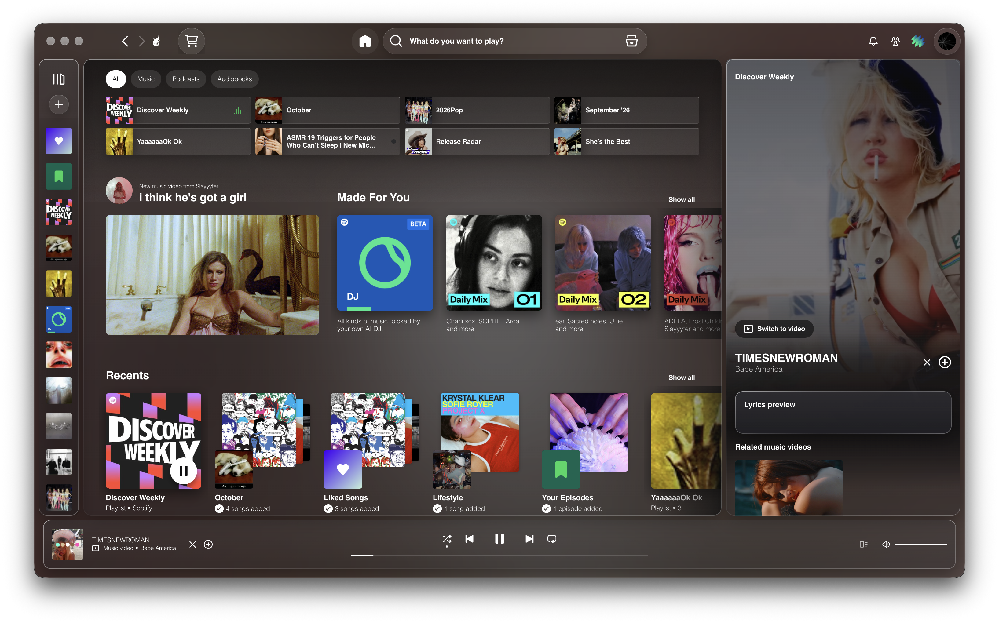

# Glass

A frosted liquid glass theme for Spotify, built with [Spicetify](https://spicetify.app).



## Features

- **Swirling album art background** that slowly drifts behind the whole app and changes with every song
- **Frosted liquid glass** panels, cards, tiles, buttons, and menus, with light-catching edges and a soft milky haze
- **Minimal floating player bar** with a plain play button and a hairline progress bar (timestamps appear on hover)
- **Now playing screen** that fills the window, opened from the button next to the volume control
  - **Cover Flow view:** your recent songs on the left, what's coming up on the right, with mirror reflections. Scroll with your trackpad or mouse wheel, or use the arrow keys, to browse. Click a side cover to bring it to the center, and click the center cover (or press Enter) to play it.
  - **Lyrics view:** synced lyrics next to the album cover, over a blurred version of the album's colors. Click any line to jump to that part of the song.
- **Synced lyrics in the sidebar**, showing three lines at a time that follow along with the song
- **Clean playlist pages:** Spotify's color bands and big image headers are replaced with a consistent glass look and a square cover

## Lightweight by design

Glass is built to look rich without slowing Spotify down, so it runs well even on older or lower-powered computers.

- **The background is tiny.** Album art is blurred once per song into a small image, then animated on a 160-pixel canvas that your graphics chip stretches to fill the window. It redraws 20 times a second while Spotify is in focus, 5 times a second when it isn't, and stops completely when Spotify is minimized.
- **No live blur on panels.** The glass panels, cards, and buttons use a tint, a highlight edge, and a soft shadow rather than real-time blur, since the background behind them is already blurred. Real blur is only used on pop-up menus and the search dropdown, which are only on screen briefly.
- **Page checks only run when something changes.** The theme watches for Spotify updating the page instead of scanning on a timer, checks at most once a second, and stops re-checking any element after a few looks.
- **Cover Flow only loads what you can see.** Covers are loaded as they come near the center and unloaded once you scroll far away from them.
- **Lyrics are fetched once per song** and shared between the sidebar and the full-screen view.
- **No audio visualizers** or other constant animations beyond the background.

## Privacy and safety

Glass is just a Spicetify theme: three plain text files (`color.ini`, `user.css`, and `theme.js`) that you can open and read before installing. Nothing is compiled, minified, or hidden, and there's no installer.

**What the script connects to:**

- **Spotify's own servers** (`spclient.wg.spotify.com` and `api.spotify.com`) to fetch lyrics and playlist covers, using the login the Spotify app already has. That login is only ever sent to Spotify.
- **Spotify's image server** (`i.scdn.co`) to load album art.
- **[LRCLIB](https://lrclib.net)**, a free and open lyrics database, only when Spotify doesn't have lyrics for a song. It receives the song title and artist name, nothing else.

**What it doesn't do:** no analytics or tracking, no data saved or sent anywhere else, no ads, no accounts, and no outside scripts loaded.

Glass runs on [Spicetify](https://spicetify.app), an open-source tool that modifies the Spotify desktop app. To undo everything at any time, run `spicetify restore`.

## Install

You'll need [Spicetify](https://spicetify.app) installed first.

**macOS / Linux** (Terminal)

```bash
cd "$(spicetify path userdata)/Themes"
git clone https://github.com/epxii/glass-theme glass
spicetify config current_theme glass color_scheme Glass
spicetify config inject_css 1 replace_colors 1 overwrite_assets 1 inject_theme_js 1
spicetify apply
```

**Windows** (PowerShell)

```powershell
cd "$(spicetify path userdata)\Themes"
git clone https://github.com/epxii/glass-theme glass
spicetify config current_theme glass color_scheme Glass
spicetify config inject_css 1 replace_colors 1 overwrite_assets 1 inject_theme_js 1
spicetify apply
```

## If the theme disappears

Spotify updates itself every so often, and each update removes Spicetify's changes. To bring the theme back, run:

```bash
spicetify backup apply
```

## Updating

To get the latest version of Glass:

```bash
cd "$(spicetify path userdata)/Themes/glass"
git pull
spicetify apply
```

## Removing

To go back to Spotify's normal look, run:

```bash
spicetify restore
```

This removes all Spicetify customizations, not just this theme.

## Notes

- Lyrics come from Spotify first, with [LRCLIB](https://lrclib.net) as a fallback for songs Spotify doesn't have lyrics for.
- Designed on macOS. Windows uses Arial in place of Helvetica, which looks nearly identical.
- Spotify sometimes renames parts of its app in updates. If something stops looking right after an update, please open an issue with a screenshot.

## License

MIT
